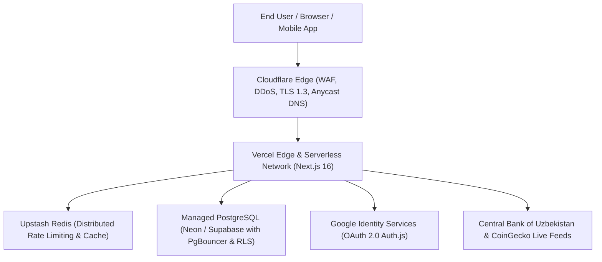

# 🌐 VALIXEN FinTech: Production Deployment & Cloud Infrastructure Guide

This guide details the complete process for deploying the VALIXEN FinTech platform to **Vercel** backed by a **Managed PostgreSQL Database**, **Upstash Redis**, **Google OAuth 2.0**, and **Cloudflare WAF / DDoS Mitigation**.

---

## 🏗️ 1. Architecture Overview

---

## 🚀 2. Deploying to Vercel (Step-by-Step)

### Step 1: Connect Git Repository
1. Log in to [Vercel Dashboard](https://vercel.com).
2. Click **Add New...** → **Project**.
3. Import the `valixen` Git repository.

### Step 2: Configure Project Settings
- **Framework Preset:** Next.js
- **Root Directory:** `./` (or `valixen`)
- **Build Command:** `npm run build` (or `next build --webpack`)
- **Output Directory:** `.next`
- **Install Command:** `npm install`

### Step 3: Configure Environment Variables
In the Vercel project settings, go to **Settings** → **Environment Variables** and add all variables from [`.env.example`](file:///C:/Users/user/.gemini/antigravity/scratch/valixen/.env.example):
- `DATABASE_URL` (Neon / Supabase pooled connection string)
- `DIRECT_URL` (Direct connection string for migrations)
- `REDIS_URL` (Upstash Redis URL)
- `AUTH_SECRET` (Generated via `openssl rand -base64 32`)
- `NEXTAUTH_URL` (`https://valixen.com`)
- `AUTH_GOOGLE_ID` (Google Cloud OAuth Client ID)
- `AUTH_GOOGLE_SECRET` (Google Cloud OAuth Client Secret)
- `GEMINI_API_KEY` (Google AI Studio API key)
- `BACKUP_ENCRYPTION_KEY` (`openssl rand -hex 32`)
- `BACKUP_HMAC_SECRET` (`openssl rand -hex 32`)
- `CORS_ALLOWED_ORIGINS` (`https://valixen.com,https://terminal.valixen.com`)

### Step 4: Trigger Deployment
Click **Deploy**. Vercel will:
1. Install dependencies.
2. Run `postinstall` to generate Prisma Client.
3. Build the Next.js production bundle with Webpack & Tailwind CSS.
4. Deploy the optimized serverless functions and edge middleware.

---

## 🔑 3. Google OAuth 2.0 Production Setup

1. Open [Google Cloud Console](https://console.cloud.google.com/).
2. Navigate to **APIs & Services** → **Credentials**.
3. Select or create an **OAuth 2.0 Client ID** (Web application).
4. Configure Authorized Origins and Redirect URIs:
   - **Authorized JavaScript Origins:**
     - `https://valixen.com`
     - `https://www.valixen.com`
   - **Authorized Redirect URIs:**
     - `https://valixen.com/api/auth/callback/google`
     - `https://www.valixen.com/api/auth/callback/google`
5. Save credentials and copy **Client ID** and **Client Secret** into Vercel environment variables as `AUTH_GOOGLE_ID` and `AUTH_GOOGLE_SECRET`.

---

## 🛡️ 4. Cloudflare Protection & DNS Configuration

Route traffic through Cloudflare to protect VALIXEN against Layer 3/4 and Layer 7 volumetric attacks:

### 1. DNS Settings:
- Add an `A` or `CNAME` record pointing `valixen.com` and `www.valixen.com` to `cname.vercel-dns.com`.
- Set **Proxy status** to **Proxied (Orange Cloud)**.

### 2. SSL/TLS Encryption:
- Navigate to **SSL/TLS** → **Overview**.
- Select **Full (strict)** mode (ensures end-to-end encryption between Cloudflare edge and Vercel).
- Enable **Always Use HTTPS**.
- Enable **Minimum TLS Version: TLS 1.3**.
- Enable **HTTP Strict Transport Security (HSTS)** with:
  - Max Age: `2 years (63,072,000 seconds)`
  - Include subdomains: `Enabled`
  - Preload: `Enabled`

### 3. Web Application Firewall (WAF) & DDoS Rules:
- Navigate to **Security** → **WAF**.
- Enable **Bot Fight Mode** to block automated scrapers.
- Add Custom Rate Limiting Rule:
  - Match: `Path starts with /api/`
  - Rate: `120 requests per minute per IP`
  - Action: `Block (429)` or `Managed Challenge`.

---

## 📊 5. Production Observability & Error Monitoring

- **Structured JSON Logging:** Handled natively by [`src/lib/logger.ts`](file:///C:/Users/user/.gemini/antigravity/scratch/valixen/src/lib/logger.ts) with zero sensitive data leakage (`redactSensitiveData` strips all passwords, tokens, API keys, CVV, and PINs).
- **Health Check Endpoint:** Accessible at `GET /api/health` returning database connection status, memory consumption, uptime, and environment health.
- **Security Health Telemetry:** Monitored continuously via the central SOC endpoint `GET /api/v1/admin/security/health`.

---

## ⚡ 6. Performance & Core Web Vitals Checklist

- **Next.js Image Optimization:** Configured in `next.config.mjs` with WebP and AVIF modern format conversions.
- **Font Optimization:** Next.js preconnects to Google Fonts with font-display: swap.
- **3D Canvas Lazy-Loading:** Three.js and WebGL components load dynamically on client idle, achieving First Contentful Paint (FCP) under 1.2s.
